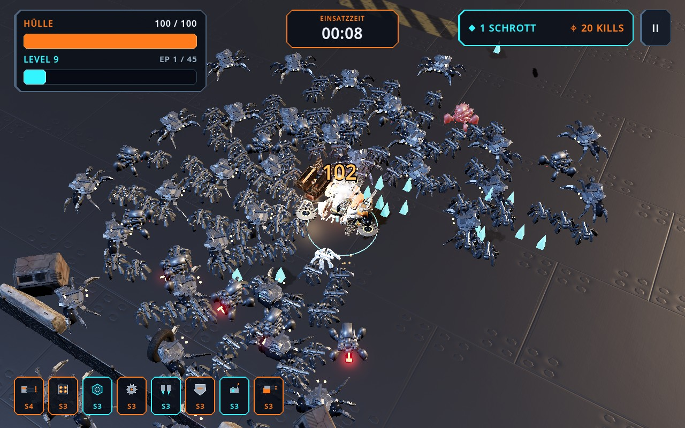
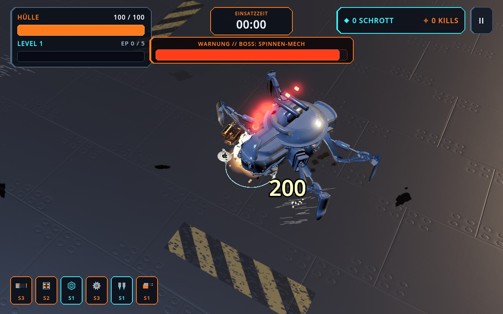
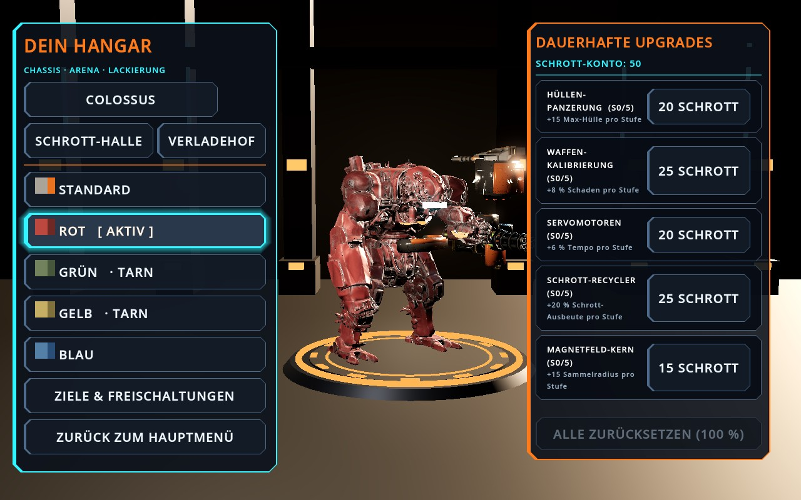
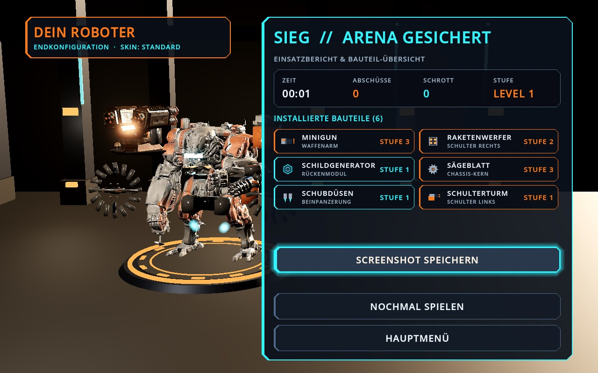
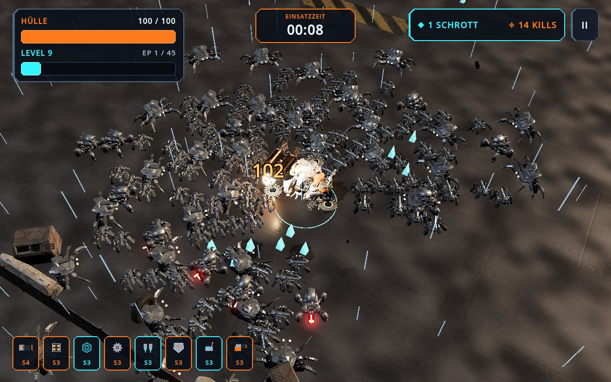

# Scrapforge v0.2

Ein modularer Roguelike-Survivor: Der Mech bewegt sich durch eine Arena, feuert automatisch und sammelt Schrott für Aufstiege und Beutekisten. Wähle Waffen- und Support-Module, schalte **Waffen-Evolutionen** (wie Schwarm-Werfer, Vulcan, Prisma-Laser, Inferno, Singularität, Bastion-Schild oder Drohnen-Schwarm) frei und stelle dich Elitegegnern sowie dem Boss nach fünf Minuten Einsatzzeit.

Im Hangar stehen fünf Lackierungen, **dauerhafte Hangar-Upgrades** (Hüllen-Panzerung, Waffen-Kalibrierung, Servomotoren, Schrott-Recycler, Magnetfeld-Kern), Ziele & Freischaltungen sowie die **zweite Arena (Verladehof)** mit Nachtregen und dem Belagerungs-Koloss zur Auswahl. Das Ergebnis zeigt Statistiken und den fertigen Mech; ein Screenshot lässt sich im Godot-Benutzerordner speichern. Im Einstellungsmenü werden Grafikqualität, Lautstärke für Master, Musik und Effekte, Bildschirmwackeln und Vollbild gespeichert.

Die Arena zeigt den Colossus Walker 2 mit modularen Waffen, Spinnengegnern, Sturm-Drohnen und Bossen. Die Blender-Aufbereitung ist unter [tools/blender/](tools/blender/README.md) beschrieben. Angaben zu verwendeten Fremdassets und ihren Lizenzen stehen in [CREDITS.md](CREDITS.md).

## Screenshots

| Schwarm (Schrott-Halle) | Boss: Spinnen-Mech |
|---|---|
|  |  |
| **Hangar & Dauerhafte Upgrades** | **Einsatzbericht** |
|  |  |
| **Verladehof (Zweite Arena)** | |
|  | |

## Steuerung

- Tastatur: WASD oder Pfeiltasten bewegen den Mech, Escape pausiert oder geht zurück; Pfeiltasten und Enter bedienen Menüs.
- Controller: linker Stick bewegt den Mech, Steuerkreuz navigiert, A bestätigt, B geht zurück und Start pausiert.
- Touch: links den virtuellen Stick ziehen; Menüs, Aufstiegskarten und Pause-Schaltfläche antippen. Android verwendet das Querformat.

## Entwicklung und Plattformen

Das Projekt verwendet Godot 4.7.2 und enthält Exportvorgaben für Windows x86-64, Linux x86-64 und Android arm64. Projekt importieren und Tests ausführen:

```sh
godot --headless --editor --path . --quit
godot --headless --path . --script res://tests/test_ui.gd
godot --headless --path . --script res://tests/test_audio.gd
# Ebenso alle weiteren tests/test_*.gd ausführen.
```

Unter Windows und Linux gehören die exportierte ausführbare Datei und die gleichnamige `.pck` zusammen. Ein Android-Debug-Export benötigt das Android SDK, JDK und einen Debug-Keystore in den lokalen Godot-Editor-Einstellungen.

## Updates und Releases

Beim Start prüft das Spiel anonym das neueste GitHub-Release; im Hauptmenü kann die Suche manuell gestartet werden. Eine verfügbare Version zeigt Release-Notizen und öffnet auf Wunsch die Release-Seite beziehungsweise auf Android den APK-Download im Browser. Die Installation erfolgt anschließend durch den Benutzer; ein automatischer In-App-Download oder Installer ist nicht implementiert.

Ein gepushtes Tag wie `v0.2.0` startet den Release-Workflow für Windows, Linux und eine debug-signierte Android-APK. Der Workflow verwendet einen temporären Debug-Schlüssel: Für Store-Releases ist ein eigener dauerhaft gesicherter Release-Schlüssel und eine entsprechend konfigurierte Signierung erforderlich.

Quellen und Lizenzen der verwendeten Fremdassets stehen in [CREDITS.md](CREDITS.md).
